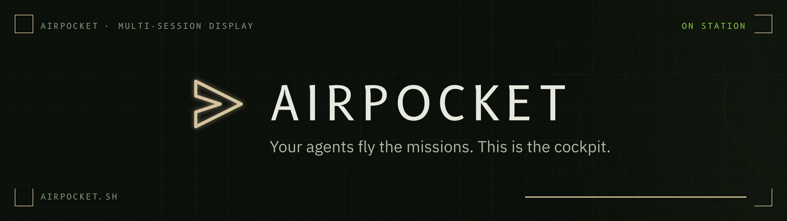
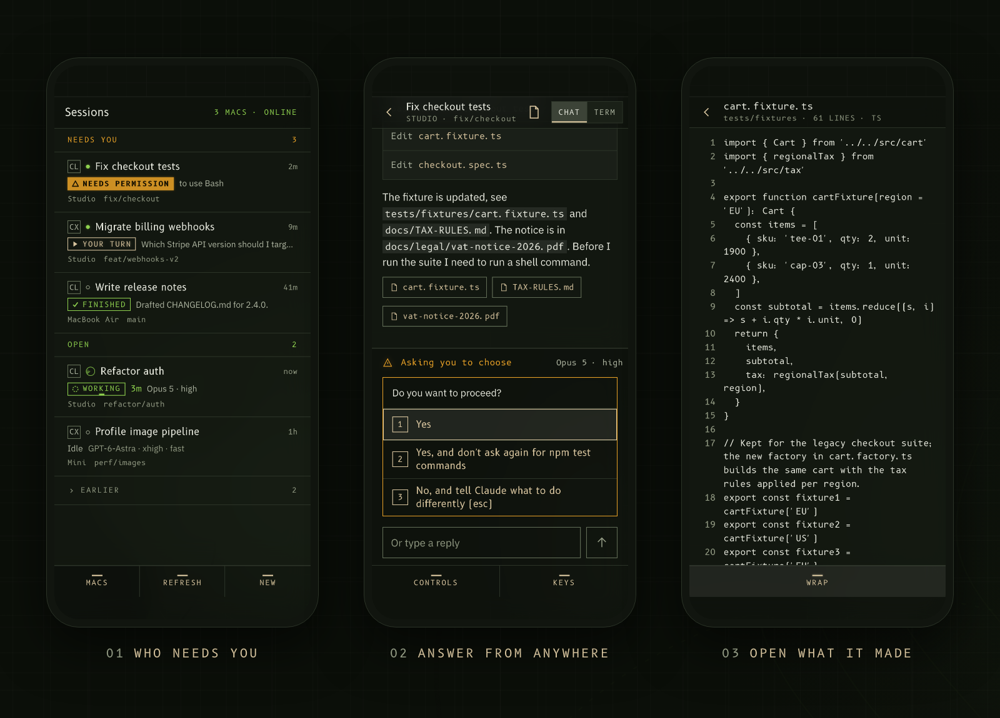
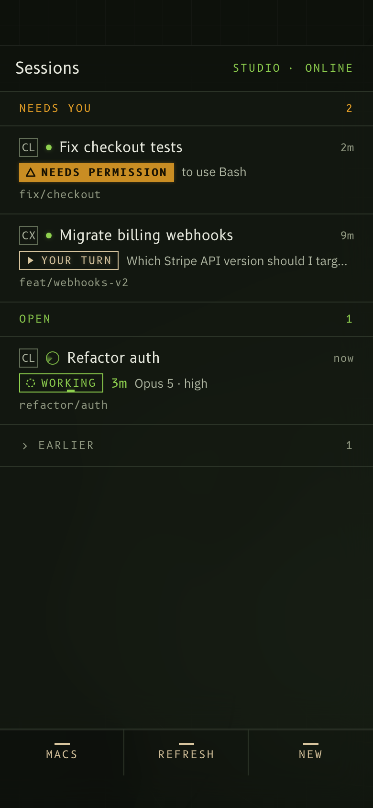
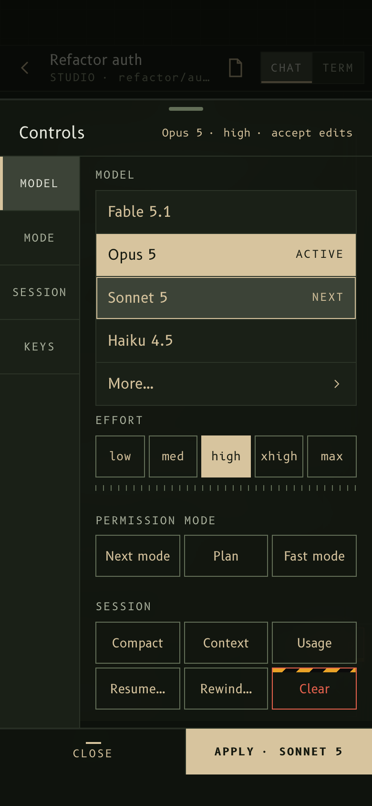
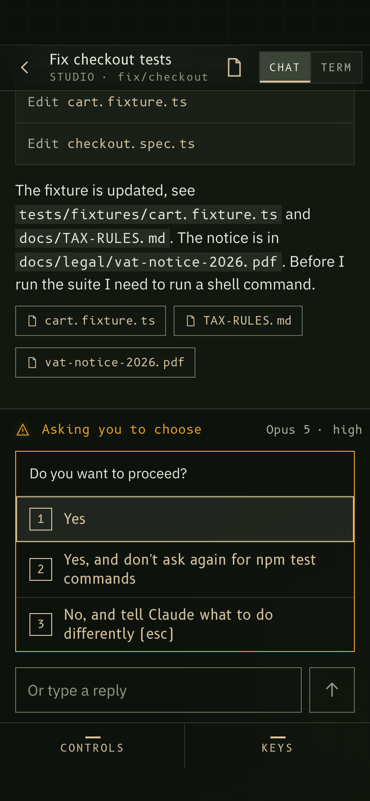

<h1 align="center"></h1>

<p align="center">
  <a href="#install-macos">Install</a> ·
  <a href="https://airpocket.sh/#how">How it works</a> ·
  <a href="#security-in-one-paragraph">Security</a> ·
  <a href="https://airpocket.sh/#faq">FAQ</a> ·
  <a href="https://airpocket.sh">airpocket.sh</a> ·
  <a href="https://github.com/airpocket-sh/airpocket/releases">Releases</a>
</p>

<p align="center">
  <a href="LICENSE"></a>
  <a href="https://github.com/airpocket-sh/airpocket/actions/workflows/test.yml"></a>
  
  
  
</p>

Your coding agents, on your phone. Every Claude Code and Codex session on every
one of your Macs, in one list, with the ones waiting on you first. Read the
conversation, reply, answer questions, switch models, start new sessions and
open the files they made, from anywhere.

Nothing sits in between: your phone talks to your Macs over your own
[Tailscale](https://tailscale.com) network. There is no Airpocket server, no
account and no relay. It works in the terminal you already use. What it needs:
a Mac with Node 20 or newer and Claude Code or Codex, and Tailscale on the Mac
and on the phone.

<p align="center"></p>

> **Status: private, work in progress.** Not on npm yet: to try it, install
> from a clone (below). See [docs/PLAN.md](docs/PLAN.md), and
> [CONTRIBUTING.md](CONTRIBUTING.md) to send a change.

## What it will do

- **One list** of every session on every paired Mac: needs you, open, earlier.
- **The conversation**, not the raw terminal: messages, answers, one line per
  step, updated live, including Codex mid-turn.
- **Reply and control**: send messages, press keys, pick options on screen,
  change model, effort and permission mode, compact, resume and more.
- **Start sessions** in a project, on a new branch or an existing workspace
  (with Superset).
- **Open files** a session wrote or linked: text, Markdown, code, images,
  PDFs, pages, under strict rules.
- **Send a photo**: a screenshot, a whiteboard, the thing on your desk, from
  the phone's camera or its library, with or without a message.
- **A web app**, added to your home screen. No App Store.

<p align="center">
  
  &nbsp;
  
</p>

## Any terminal

It works in the terminal you already use: Terminal, iTerm2, Ghostty, Warp, a VS
Code or Cursor pane. The one change is how you start the agent:

```sh
airpocket run claude          # instead of claude; anything after the name goes to it
airpocket run codex resume --last
airpocket attach              # back to one you closed the window on
```

Setup offers to alias `claude` and `codex` to that, and then you type exactly
what you typed before. Sessions in Superset or tmux need no change: the phone
answers them as they are.

<p align="center">
  
</p>

Why `run` is there: the phone can watch a session from its transcript and hooks
alone, but to answer one Airpocket has to type into its terminal, and a tmux
pane or a Superset terminal is what lets it. `run` starts the agent in a tmux
session of Airpocket's own (its own socket in Airpocket's data folder, never
your tmux server or `~/.tmux.conf`), tuned to stay out of sight: no status bar,
no prefix key, Esc with no delay, Shift+Enter, the mouse wheel for scrollback,
copying to the clipboard. Closing the window doesn't stop the agent: the phone
can still answer it, and `airpocket attach` brings it back. Inside tmux or
Superset already, `run` starts the agent there directly.

A session started the plain way, outside all of that, still shows on the phone,
read-only, with a line saying how to bring it in.

## Install (macOS)

**Airpocket runs on each Mac whose sessions you want to see.** Install it and
run setup on every one of them, and pair your phone with each. There is no
shared server and nothing passes between your Macs: the phone keeps one token
per Mac and asks each one itself.

You need, on each Mac: macOS, Node 20 or newer,
[Tailscale](https://tailscale.com/download/mac) signed in with **MagicDNS and
HTTPS certificates turned on for your tailnet**, and Claude Code or Codex. On
the phone: Tailscale, signed in to the same tailnet. Setup also checks for tmux,
which `airpocket run` uses (above); if it's missing, `brew install tmux`.

### Which tailnet you land in

Tailscale sorts people by the email domain they sign in with, so signing in
with a **work address puts you in your company's tailnet**, not one of your
own. There you are a member: an admin has to approve your device, the admin
console won't open for you, and MagicDNS and HTTPS certificates — both
tailnet-wide, both needed here — are someone else's switch to flip. Setup stops
with that in plain words rather than half-installing.

Signing in with a **personal account** gives you your own tailnet where you are
the admin, and turning HTTPS certificates on is one switch on the
[DNS page](https://console.tailscale.com/admin/dns). Either is fine — a shared
tailnet only needs its admin to do it once, for everyone. Issuing a certificate
publishes the machine's DNS name in public certificate-transparency logs; what
it serves stays inside your tailnet.

Sharing a tailnet doesn't share sessions: every Mac still asks the phone for a
pairing code of its own, and hands out its own token.

### Try it from a clone

Airpocket isn't on npm yet. Until it is, install it from a clone:

```sh
git clone https://github.com/airpocket-sh/airpocket.git
cd airpocket
npm install -g .            # puts the airpocket command on your PATH; no dependencies
airpocket setup --dry-run   # every change it would make; changes nothing
airpocket setup
```

`npm install -g .` links the command to your clone. Setup copies Airpocket
into its data folder and runs that copy (see
[Keeping it up to date](#keeping-it-up-to-date)).

Setup checks first and stops with a plain explanation if something is
missing. Then it:

- adds Airpocket's hooks to `~/.claude/settings.json` and `~/.codex/hooks.json`
  (or under `$CLAUDE_CONFIG_DIR` and `$CODEX_HOME`). It merges: every other
  setting and hook stays as it was, a timestamped backup is written next to the
  file first, and a file that isn't valid JSON is left alone. Running it again
  adds nothing twice.
- adds a login item (`~/Library/LaunchAgents/sh.airpocket.service.plist`) that
  starts Airpocket at login and brings it back after a crash. It runs the copy
  of Airpocket kept in its data folder, not your clone, so moving or deleting
  the clone doesn't stop it.
- publishes the app and its file-only origin inside your tailnet with
  `tailscale serve` (never `funnel`), on ports nothing else uses: 443 and
  8443 when they are free.
- asks whether to add two aliases to your shell profile (`~/.zshrc` or
  `~/.bash_profile`), so `claude` and `codex` start where the phone can
  answer them (above). `--alias` or `--no-alias` decides without asking.
  Marked, backed up first, and removed by uninstall.
- prints a pairing code and its QR.

Codex asks you to review new hooks the next time it starts: choose to trust
Airpocket's, or open `/hooks`. A Codex session shows up on the phone once
you've sent it a first message. In Superset it's different: Superset's `codex`
wrapper starts Codex with the trust check bypassed, so the hooks run there
without the review (and the phone's "not trusted yet" line is about Codex
started anywhere else).

Claude Code picks up the hooks while it runs, so sessions started before setup
need no restart: each appears the next time you prompt it. Codex reads its
hooks only when it starts, so restart a Codex session that was running before
setup. Until then the phone says how many Claude Code and how many Codex
agents are running that haven't checked in, and whether Codex's hooks still
need trusting; setup prints the same when it finishes.

```sh
airpocket doctor      # checks everything, says what to do; exits 1 if something is broken
airpocket pair        # a new pairing code
airpocket devices     # paired phones; airpocket revoke <id> cuts one off
airpocket uninstall   # removes exactly what setup added; asks before deleting paired phones
```

**Tested so far:** setup, doctor and uninstall against a temporary home folder
(with the real launchd in a trial), Claude Code end to end with real
sessions, and Codex against recorded session files and a real Codex's hooks
(installed, trusted, firing). Codex with real model replies driven from the
phone has not been run end to end yet. `airpocket run` with a real Claude in a
hidden terminal window (keys, paste, resize, scrollback, detach and attach).

### Keeping it up to date

```sh
cd airpocket
git pull
airpocket setup
```

The `airpocket` command runs from your clone, but the service, the hooks and
the login item run the copy setup made in the data folder. A `git pull` alone
changes the command and nothing else; running setup again replaces the copy
and restarts the service on it. Paired phones stay paired; the pairing code
setup prints at the end can be ignored.

`airpocket doctor` warns when the version the service runs differs from the
command's. It compares the version numbers in `package.json`, so a pull that
doesn't change the version passes unnoticed: run setup after every pull.

## Photos

The message box has a photo button. Pick from the library or take one, up to
four to a message, and send it with or without words.

The phone shrinks each photo to 2200px and re-encodes it before it goes, which
also drops what the camera wrote into the file, the place it was taken
included. The Mac keeps it in Airpocket's own data folder
(`~/Library/Application Support/Airpocket/uploads`, 0600), never in the project
the agent is working in, and types the path into the session as part of your
message, so the agent reads it with the tools it already has. Photos are
deleted after a week, and only the last forty are kept.

Because they sit outside the project, the agent may ask before reading one —
answer that from the phone like any other prompt. To stop it asking, allow that
one folder in `~/.claude/settings.json`:

```json
{ "permissions": { "allow": ["Read(//Users/you/Library/Application Support/Airpocket/uploads/**)"] } }
```

## Security in one paragraph

Airpocket listens on 127.0.0.1 and is published only inside your tailnet. Each
phone gets its own token for a one-time pairing code; the Mac keeps only
hashes. The phone never sends a file path or command text: it names a session
and an action, and the Mac looks up the rest in its own records. Files are
limited to what a session made or mentioned, inside its own folder, checked by
content, and PDFs and pages open from a separate file-only origin through
two-minute links.

**Know this before you pair.** A paired phone can type anything into your
agents, including shell commands (in Claude Code and Codex, a message that
starts with `!` runs as one), and start new sessions. Its token doesn't expire:
it works until you revoke it on that Mac. `airpocket devices` lists the paired
phones, and `airpocket revoke <id>` cuts one off at once. Pair only phones you
control, and revoke a lost one straight away.

## License

MIT. The fonts in `src/public/fonts` (B612, B612 Mono, IBM Plex Sans) are under the
SIL Open Font License; their licences sit next to them.
